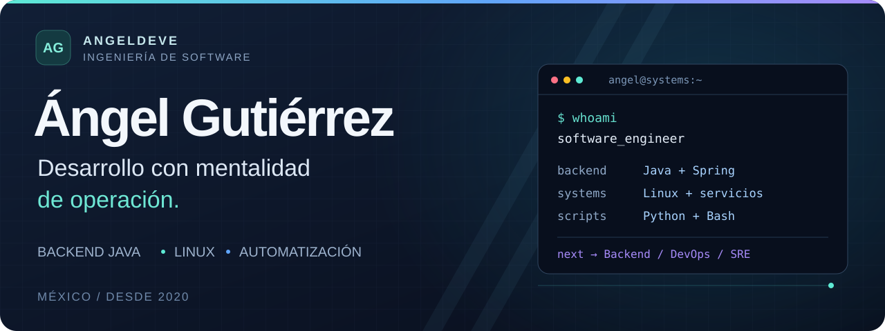
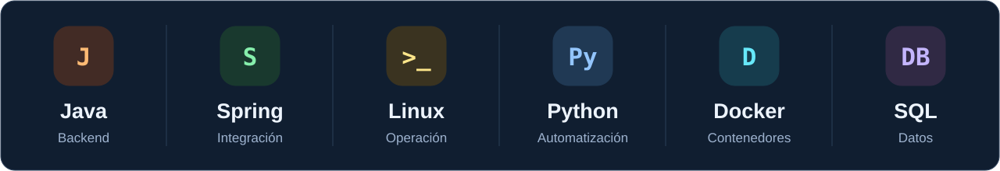
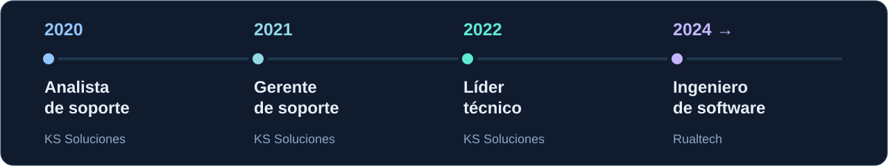

  <picture>
    <source media="(max-width: 600px)" srcset="assets/banner-mobile.svg" />
    
  </picture>

  <a href="https://github.com/AngelDeve">GitHub</a> ·
  <a href="https://www.linkedin.com/in/angel-gutierrez-2092a81bb/">LinkedIn</a> ·
  <a href="mailto:angelgutierrezdeveloper@gmail.com">Contacto</a>

## Hola, soy Ángel

Soy **Ángel Gutiérrez**, ingeniero de software en México. Empecé en **2020** atendiendo sistemas transaccionales en producción. Después coordiné un equipo de soporte, asumí el liderazgo técnico de componentes críticos y continué mi camino en el desarrollo de aplicaciones empresariales.

Ese recorrido conecta lo que hago hoy: **desarrollar backend, entender cómo se comportan los sistemas y automatizar su operación**. Trabajo con Java y Spring, Linux, Python y Bash, con especial interés en la integración de sistemas y la continuidad del servicio.

> Mi experiencia en producción acompaña mi forma de escribir código: diagnóstico, trazabilidad y contexto operativo.

  <picture>
    <source media="(max-width: 600px)" srcset="assets/impacto-mobile.svg" />
    
  </picture>

## Donde el código se encuentra con producción

| Construir | Operar | Mejorar |
| :--- | :--- | :--- |
| Backend Java, componentes Spring e integración de sistemas de procesamiento de tarjetas. | Servicios Linux, diagnóstico de incidentes y análisis de causa raíz en entornos transaccionales. | Automatización con Python y Bash, documentación y acompañamiento técnico a equipos. |

## En construcción · Trama8583

Mi proyecto de biblioteca Java para **construir, interpretar y validar mensajes ISO 8583** mediante perfiles configurables. Reúne dos áreas de mi trayectoria: Java e integración de sistemas transaccionales.

- **La propuesta:** un núcleo propio, configurable mediante perfiles explícitos.
- **El enfoque:** una API y documentación en español para desarrolladores de Latinoamérica.
- **El estado:** en desarrollo, sin una versión publicada.

**[Explorar el proyecto →](https://github.com/AngelDeve/trama8583)**

<strong>También exploro servicios con Java y Spring</strong>

Repositorios de práctica para explorar desarrollo backend y colaboración entre servicios:

- [servicio-productos](https://github.com/AngelDeve/servicio-productos): Spring Web, persistencia con JPA y base de datos H2.
- [servicio-item](https://github.com/AngelDeve/servicio-item): comunicación entre servicios con OpenFeign e integración con Eureka.
- [servicio-eureka-server](https://github.com/AngelDeve/servicio-eureka-server): registro y descubrimiento de servicios con Spring Cloud Netflix Eureka.

## Mi caja de herramientas

  <picture>
    <source media="(max-width: 600px)" srcset="assets/tecnologias-mobile.svg" />
    
  </picture>

<strong>Ver tecnologías y herramientas por área</strong>

| Área | Tecnologías y herramientas |
| :--- | :--- |
| **Backend** | Java 8 y 21 · Spring · Spring Integration · Xojo |
| **Automatización** | Python · Bash · SQL |
| **Sistemas y servicios** | Linux: Red Hat, Debian y Ubuntu · systemd · Supervisor · Redis |
| **Datos** | MariaDB · MySQL · SQLite · Flyway |
| **Desarrollo y entrega** | Git · GitLab · Docker |
| **Calidad y colaboración** | Squash TM · IceScrum · OpenProject · Scrum · documentación técnica |

## Mi recorrido

  <picture>
    <source media="(max-width: 600px)" srcset="assets/recorrido-mobile.svg" />
    
  </picture>

Cada etapa amplió mi perspectiva: de resolver incidencias a coordinar personas, tomar decisiones técnicas y desarrollar soluciones con conocimiento de su operación.

<strong>Ver experiencia y responsabilidades</strong>

### Rualtech · Ingeniero de software

**Noviembre de 2024 – actualidad.** Desarrollo y mantenimiento de aplicaciones empresariales con Xojo y bases de datos relacionales. Automatización con Python y Bash, administración y diagnóstico de servicios Linux, revisión de código en GitLab y colaboración con equipos operativos.

### KS Soluciones

| Periodo | Rol | Responsabilidad principal |
| :--- | :--- | :--- |
| Ago. 2022 – oct. 2024 | **Líder técnico** | Tres componentes de un sistema de monitoreo transaccional de alta disponibilidad; desarrollo Java/Spring, incidentes complejos e integraciones. |
| Oct. 2021 – ago. 2022 | **Gerente de soporte de sistemas** | Coordinación de cinco ingenieros, priorización de incidentes, control de actualizaciones y documentación técnica. |
| Feb. 2020 – oct. 2021 | **Analista de soporte de sistemas** | Operación y soporte 24/7, diagnóstico de fallos y resolución de incidencias en producción. |

Mi formación incluye **Técnico en Programación por el IPN** y estudios de **Ingeniería Matemática en la ESFM hasta sexto semestre**.

## Hacia dónde sigo

Sigo fortaleciendo mi camino en **backend, DevOps y SRE**. Mi siguiente paso es profundizar en contenedores, CI/CD y prácticas de confiabilidad, apoyándome en mi experiencia de operación y desarrollo.

---

  <strong>¿Conversamos sobre backend, integración o automatización?</strong> 
  <a href="https://www.linkedin.com/in/angel-gutierrez-2092a81bb/">Conecta conmigo en LinkedIn</a> ·
  <a href="mailto:angelgutierrezdeveloper@gmail.com">Escríbeme</a>

